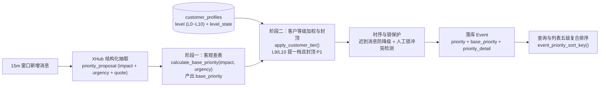

# 事件业务优先级现有实现说明

更新日期：2026-11-18  
状态：已合入主干并经全量 `L6~L10` 大客户增量回放验证。

> **口径声明**：优先级档位（`P0 / P1 / P2 / P3 / 待评估`）、`Impact × Urgency` 查表矩阵与 `L9/L10` 超级大客加权封顶规则，均为本项目集中可配置的本地工程口径，不冒充外部已公布的官方评分枚举；持久化时同时保留兼容字段 `severity` 与完整证据推导明细 `priority_detail`。

---

## 一、设计目标与核心分工

在售后群增量分析场景中，若直接让大模型凭感觉输出 `"P0"` 或 `"紧急"`，极易出现两类失真：一是客户随口一句“尽快看下”就被误标为最高级故障；二是模型猜错客户身份等级或前后窗口标准不一。

当前实现采用**「两阶段解耦 + 确定性规则拍板」**架构：
1. **模型层（文本客观信号抽取）**：模型在单窗口抽取中仅输出客观 **业务影响度（`impact`）** 与 **时间紧迫度（`urgency`）**，并强制附带本轮消息 `evidence_ids` 与连续原文子串 `quote`；模型**不读取、不猜测客户等级**。
2. **规则层（确定性查表与身份加权）**：后端纯函数先由 `Impact × Urgency` 查表计算**基础优先级（`base_priority`）**，再结合本地客户目录 `customer_profiles` 中已确认（`fresh`）的客户等级执行超级大客提档与 `P1` 封顶，得出**最终优先级（`priority`）**。
3. **人机协同层（人工纠偏与锁定保护）**：支持人工覆盖优先级并加锁（`locked=true`），后续增量窗口自动保护人工结论不被模型覆盖，遇到新反向证据时挂出 `待核对` 提示。



---

## 二、代码模块职责映射

| 层次 | 文件路径 | 核心职责 |
| :--- | :--- | :--- |
| **领域规则** | [priority_policy.py](file:///d:/projects/dake-aftersales/backend/src/dake/domain/priority_policy.py) | 定义档位枚举、`BASE_PRIORITY_MATRIX` 二维查表、`SUPER_LARGE_BOOST_MAP` 提档封顶、迟到防降级评估 `evaluate_priority_proposal()`、列表复合排序键 `event_priority_sort_key()` |
| **领域模型** | [models.py](file:///d:/projects/dake-aftersales/backend/src/dake/domain/models.py) | `Event` 与 `Candidate` 上的 `priority`、`base_priority`、`priority_detail` 定义及存量 `severity` 兼容归一化 |
| **人工控制** | [manual_controls.py](file:///d:/projects/dake-aftersales/backend/src/dake/domain/manual_controls.py) | 定义 `priority` 字段人工锁校验、锁定冲突记录 `record_lock_conflict()` 与 `review_flag` 合成 |
| **抽取提示词** | [06_priority_signals.md](file:///d:/projects/dake-aftersales/backend/src/dake/analysis/prompts/sections/06_priority_signals.md) | 独立提示词分块定义 `impact` 与 `urgency` 各档客观锚点与防虚高红线 |
| **输出合约校验** | [contract.py](file:///d:/projects/dake-aftersales/backend/src/dake/analysis/contract.py) | `PriorityProposal` 严格 JSON Schema 校验、非空理由核验、候选消息范围与连续原文 `quote` 核对 |
| **增量合并与落库** | [attribution.py](file:///d:/projects/dake-aftersales/backend/src/dake/services/attribution.py) / [updates.py](file:///d:/projects/dake-aftersales/backend/src/dake/analysis/updates.py) | 同批多候选 `_pick_higher_priority_proposal()` 合并、跨窗时序判断、人工锁保护及修订快照记录 |
| **查询与人工接口** | [queries.py](file:///d:/projects/dake-aftersales/backend/src/dake/services/queries.py) / [manual_decisions.py](file:///d:/projects/dake-aftersales/backend/src/dake/services/manual_decisions.py) | 查询时动态对齐最新客户档案等级、按 `priority` 过滤与五级排序、人工改判与加解锁事务接口 |
| **前端工作台** | [EventBadges.tsx](file:///d:/projects/dake-aftersales/web/src/pages/events/components/EventBadges.tsx) / [ClassificationDetails.tsx](file:///d:/projects/dake-aftersales/web/src/pages/events/components/ClassificationDetails.tsx) / [ManualDecisionDialog.tsx](file:///d:/projects/dake-aftersales/web/src/pages/events/components/ManualDecisionDialog.tsx) | 优先级徽标与 `VIP 提档` 标识展示、详情区完整推导依据与原文跳转、列表筛选与人工纠偏加锁弹窗 |

---

## 三、数据模型与持久化字段

在 `events.payload`（及 API `EventResponse`）中，优先级由以下字段共同表达：

```json
{
  "priority": "P1",
  "base_priority": "P2",
  "severity": "P1",
  "priority_detail": {
    "priority": "P1",
    "base_priority": "P2",
    "vip_boosted": true,
    "customer_level": "L9",
    "level_state": "fresh",
    "level_note": "因 L9 超级大客由基础 P2 提升一档至 P1",
    "impact": "medium",
    "urgency": "normal",
    "reason": "批量接口请求返回 500 报错，需定位异常原因",
    "source": "automatic",
    "evidence_refs": [
      {
        "source": "official_chat",
        "message_id": "syn-msg-101",
        "quote": "这6个request返回的是Internal server error"
      }
    ]
  }
}
```

- **存量历史兼容（`normalize_legacy_priority`）**：读取早期无 `priority` 字段的历史事件时，若旧 `severity` 不在 `P0~P3` 中（如 `"未知"` 或自由文本 `"高"`），自动保守归一化为 `priority="待评估"`、`base_priority="待评估"`，并将原文本无损保存在 `priority_detail.legacy_severity`，不伪造客观证据。

---

## 四、第一阶段：客观信号提取与二维查表矩阵

### 4.1 模型提取合约（`PriorityProposal`）

当本轮新增消息包含客观业务影响或期限线索时，模型输出 `priority_proposal`（更新旧事件且本轮无新线索时输出 `null`）：
- `impact`：`Literal["critical", "high", "medium", "low", "unknown"]`
- `urgency`：`Literal["immediate", "soon", "normal", "unknown"]`
- `reason`：简明客观评估依据（必填非空）
- `evidence_ids` & `quote`：支撑该判断的消息 ID 及**逐字连续原文片段**（经 `contract.py` 校验必须在消息正文中精确命中）

### 4.2 客观维度判定标准

| 维度 | 枚举值 | 客观触发标准 |
| :--- | :--- | :--- |
| **业务影响 `impact`** | `critical` | 核心生产业务中断、大面积不可用、数据丢失/泄露、直接资损或安全风险 |
| | `high` | 核心功能严重受阻且无绕行方案、持续高频生产报错、明确执行业务迁离或终止核心合作 |
| | `medium` | 局部接口/节点异常、批量请求报错或性能显著退化、条件性流失警告、阻塞既定上线或交付节点 |
| | `low` | 个别/少量请求报错或慢请求核查、常规配置/链路排查、常规资源调整、功能改善、日常报价账单开票续费、技术核验培训 |
| | `unknown` | 仅用于完全无法判断发生了什么具体问题的残缺片段 |
| **时间紧迫度 `urgency`** | `immediate` | 线上业务正在持续受损，或原文明确当日截止死线 |
| | `soon` | 原文明确近期交付/上线/办理节点，或线上报错需当班尽快定位 |
| | `normal` | 常规排查、排期或一般跟进 |
| | `unknown` | 原文未提任何时间线索（不影响按已知 `impact` 定级） |

> **防虚高硬约束**：单句口语催促“尽快帮忙看下”若无客观中断或死线事实支撑，不得将 `impact` 升为 `critical`。

### 4.3 基础优先级查表矩阵（`BASE_PRIORITY_MATRIX`）

`calculate_base_priority(impact, urgency)` 执行确定性查表：
- 若 `impact == "unknown"`，无论紧迫度如何，一律返回 **`待评估`**（拒绝盲猜档位）。
- 其余组合查表如下：

| `impact` \ `urgency` | `immediate` | `soon` | `normal` | `unknown` |
| :--- | :---: | :---: | :---: | :---: |
| **`critical`** | **`P0`** | **`P0`** | **`P0`** | **`P0`** |
| **`high`** | **`P0`** | **`P1`** | **`P1`** | **`P1`** |
| **`medium`** | **`P1`** | **`P2`** | **`P2`** | **`P2`** |
| **`low`** | **`P2`** | **`P2`** | **`P3`** | **`P3`** |

---

## 五、第二阶段：客户等级加权与 `P1` 封顶规则

`apply_customer_tier(base_priority, level, level_state)` 结合 `customer_profiles` 表执行客户分层调整：

1. **客户等级数值安全解析（`customer_level_number`）**
   - 仅当 `level_state == "fresh"` 且 `level` 属于已知枚举 `L0 ~ L10` 时解析整数序号 `0 ~ 10`（严格保证 `L10 (10) > L9 (9) > L6 (6)`，杜绝按字符串字典序比较把 `"L10"` 排在 `"L2"` 后面）。
2. **超级大客提档与 `P1` 封顶映射（`SUPER_LARGE_BOOST_MAP`）**
   - 当客户为已确认有效的 **`L9` 或 `L10`**（`is_super_large(level, state) == True`）时：
     - 客观 `P3` 保存为 `priority_detail.objective_priority`，基础档从 `P2` 起，提档至 `P1`（`vip_boosted = True`）。
     - `P2 → P1`（`vip_boosted = True`，附说明 `因 L9/L10 超级大客由基础 P2 提升一档至 P1`）
     - **`P1 → P1`（封顶保持 `P1`，`vip_boosted = False`）**：严禁仅凭超大客身份进入 `P0`，确保工作台 `P0` 永远代表已证实的大范围关键生产中断且无绕行，或正在发生的重大安全、资损事故。
     - `P0 → P0`、`待评估 → 待评估`。
3. **普通大客与未知/过期等级处理**
   - **`L6 ~ L8`（`fresh`）**：保持 `priority == base_priority`（`vip_boosted = False`）。
   - **未知或过期等级（`unknown` / `stale`）**：不触发超级大客提档，按原客观档恢复 `base_priority` 并在 `level_note` 标注 `客户等级待确认，暂按基础优先级展示`。
4. **查询侧实时对齐**
   - 事件列表、详情和优先级筛选按报告客户与已确认受影响客户中的最高有效等级计算。人工锁保留生效档，基础档和自动建议仍随当前档案重评。

---

## 六、增量多窗口演进与时序保护规则

在 15 分钟持续增量处理中，优先级遵循以下确定性演进语义：

1. **同窗口多进展合并（`_pick_higher_priority_proposal`）**
   - 同一窗口内指向同一事件的多个进展若同时给出 `priority_proposal`，按 `PRIORITY_RANKS`（`P0 < P1 < P2 < P3 < 待评估`）保留客观基础优先级更高的一方。
2. **无新线索保持原档位（沉默不自动衰减）**
   - 后续窗口若仅为常规确认跟进（`priority_proposal = null`），保留既有 `base_priority` 与 `priority` 不变，不会因几天未提严重性就自动降级。
3. **禁止用 `待评估` 抹掉已知优先级**
   - 对已建事件（`created=False`），若后续残缺片段给出 `impact="unknown"`（`base="待评估"`）而原事件已有明确 `base_priority`，拒绝覆盖，保留原优先级。
4. **乱序/迟到消息防降级保护（`late=True`）**
   - 当回溯补采的旧消息最大发送时间早于事件当前 `end_time` 时：
     - 若旧消息揭示了比当前更高的客观影响（`PRIORITY_RANKS[base] < PRIORITY_RANKS[current_base_priority]`），允许向上修正；
     - 若旧消息等级低于或等于当前基础优先级（如早期仅是普通咨询 `P3`，后续已升级为故障 `P1`），自动忽略该迟到提案，防止旧消息把当前高优状态拉低。

---

## 七、工作台默认五级复合排序（`event_priority_sort_key`）

后端 `GET /api/v1/events` 与前端列表默认统一按以下五元组升序排列：

$$\text{SortKey}(e) = \bigl(\text{ended},\ \text{priority\_rank},\ \text{super\_rank},\ -\text{level\_num},\ -\text{end\_ts}\bigr)$$

1. **`ended`（未完结优先）**：`跟进中 / 等待中 / 状态未明` 取 `0`，`已解决 / 已取消` 取 `1`（已完结事项自动沉底，不干扰待处理主视图）；
2. **`priority_rank`（优先级档位）**：`P0 (0) → P1 (1) → P2 (2) → P3 (3) → 待评估 (4)`（保证 `L6` 客户的真实 `P0` 生产中断排在 `L10` 客户的 `P1/P2` 诉求之前）；
3. **`super_rank`（同档超大客优先）**：同档位下（如均为 `P1`），`L9/L10` 超大客（`0`）排在普通大客（`1`）之前；
4. **`-level_num`（客户等级数值倒序）**：`L10 > L9 > L8 > L7 > L6 > 等级待确认`；
5. **`-end_ts`（最新消息时间倒序）**：同等级同档位下，最近有新消息的事项排在最前。

---

## 八、人工纠偏与字段级锁定闭环

通过 `POST /api/v1/events/{event_id}/manual-decisions` 接口与工作台「人工裁定」弹窗实现闭环治理：

1. **原子提交与乐观锁防覆盖**：请求携带 `expected_version`、`operation_id`、`operator` 与必填 `reason`；版本不一致返回 `409 Conflict`，相同 `operation_id` 幂等返回原结果。
2. **人工设定与加锁（`field="priority"`）**：
   - 人工指定新档位（如 `P1`）并勾选锁定后，`event.priority` 更新为人工值，`priority_detail.source` 标记为 `"manual"`，`manual_controls["priority"]` 记录 `locked=True`、操作人、时间与原因，同时自动消解该字段下挂起的 `open` 冲突项。
3. **后续增量窗口锁保护与冲突提醒**：
   - 在 `updates.py` 中，若 `is_locked(event, "priority")` 为真且新窗口自动评估出的 `prio_eval["priority"] != event.priority`：
     - **不修改** `event.priority`（坚守人工锁定结论）；
     - 调用 `record_lock_conflict()` 在 `event.review_items` 写入 `kind="manual_lock_conflict"`，并在卡片顶栏合成 `review_flag`（如 `锁定优先级（P3）收到新评估结果（P1），待核对`），提醒人工复核。
