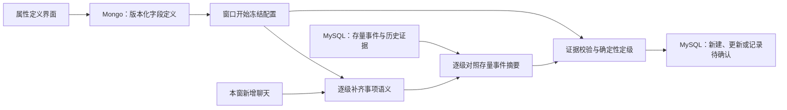

# 事件处理优化执行方案

日期：2026-11-18。状态：待评审。本方案以 `dake-main` 当前代码为基线，不修改业务代码、运行配置或存量数据。

## 1. 基线与范围

本方案补充[分类、状态与优先级增量开发方案](分类状态与优先级增量开发方案.md)，不重做六类事件、多标签、生命周期或人工锁定。业务上区分**事件等级**（沿用 `priority`，即业务处理优先级）、**影响面**（客观影响）、**紧急程度**（跟进时限与客户升级信号）、**客户等级**（客户目录月销等级）。现有 `severity` 维持兼容投影，不另建一套等级字段。

| 方向 | 当前代码 | 本轮差距 |
| --- | --- | --- |
| 属性 | [`models.py`](../backend/src/dake/domain/models.py) 的 `TYPE_ATTRIBUTE_NAMES` 已按六类列出属性；[`contract.py`](../backend/src/dake/analysis/contract.py) 的 `TypedAttribute` 目前以字符串值和引文承载 | 缺稳定字段编码、值类型、缺失语义、定义版本和维护界面 |
| 定级 | [`priority_policy.py`](../backend/src/dake/domain/priority_policy.py) 已有影响 × 紧迫度矩阵，L9/L10 提档封顶 P1 | 时间与客户情绪未分别取证；组合、例外和理由应明确可测 |
| 追溯 | [`processing.py`](../backend/src/dake/services/processing.py) 先召回存量事件及聊天背景，再发起抽取；已区分新证据与历史背景 | 现有预算是上限，不等于按信息缺口逐级扩读；需量化误拆、误并、待确认与成本 |
| 提示词 | [`xhub.py`](../backend/src/dake/analysis/providers/xhub.py) 将基础文本、代码内策略常量和 Schema 拼接；已有基础和实际提示词散列 | 规则分散；配置、合约、实际请求、分析流身份之间需要明确的版本规则 |

**范围假设**：界面化指为运营提供字段定义维护及事件详情渲染；MongoDB 存定义和定义发布记录，不存聊天、事件实例或证据。把事件实例也迁到 Mongo 是另一种解释，会改动现有 MySQL 原子提交、幂等和恢复路径，不纳入首期。默认不改变客户准入、取数来源、任务调度和真实数据授权。

## 2. 属性定义与界面化

**数据契约**：固定字段（ID、客户、分类、状态、时间、等级、负责人、摘要、证据）继续由领域合约管理。每类事件的可配置业务属性使用稳定 `field_key`，归属 `type_label`；同一事件的多标签属性分组保存，避免同名覆盖。定义包含 `label`、`value_type`、枚举选项或单位、展示顺序、取证说明、启停及缺失规则。首期支持文本、数字、枚举、布尔、日期时间；换算口径不明时不填结构化值。

事件属性值建议表示为 `{field_key, value, value_state, definition_version, evidence_refs}`。`value_state` 区分明确值、未知/未提及与明确不适用；`false`、`0` 不是缺失。先保留可核对的原文摘录，再做类型与单位归一，不能从一句模糊表述补出客户承诺、精确金额或根因。可配字段缺失不阻止建项；只有事项身份和业务证据不够才影响归属判定。

| 核验样例 | 结构化结果 | 不允许 |
| --- | --- | --- |
| 资源需求：“再加 20 个配额” | 增量 `20`、单位“个”、对应消息版本与引文；目标总量未知 | 把 20 当成目标总量 |
| 排障：“灰度环境导出一直失败” | 环境、症状可记录；根因未知 | 因“失败”推断生产中断 |
| 商务需求：“希望周五前开票” | 界定为客户期望；日期可按消息日期与业务时区无歧义解析时才归一 | 当成已承诺截止或已开票 |

**首期实施**：

1. 把现有六类字段逐项编成 v1 字典，核对中文名到稳定编码的映射、类型与旧值兼容策略。用内置 v1 快照保留现有行为；历史事件读旧值与旧引文，无法转换时标记旧格式，不补造结构化史料。
2. Mongo 按一个全局字典建草稿和不可变版本。发布前校验权限、六类基线、重复编码、类型约束、废弃值及取证说明；并发发布对活动版本做条件更新。先持久化完整版本、再切活动指针；指针切换失败时仍使用旧版，不能出现半套定义。改名不改码，停用代替删除；不兼容改型用新编码或显式迁移。
3. 新增「事件属性」设置页：按类型编辑、预览事件详情、校验、查看差异、发布与回滚。读取和编辑权限与发布权限分开；上线前需确认哪些角色可发布，权限缺失时不开放写接口。事件详情显示类型分组、值、单位与证据，旧事件按自己的版本或已有兼容映射展示。
4. 增量窗口启动时冻结版本和内容指纹，抽取、校验、展示元数据共用同一份定义；必要的历史展示信息随 MySQL 事件修订保存。本窗运行中发布的新版本下一窗才生效。Mongo 暂不可用时可用已验证、明确标识的上次发布快照；无可用快照时停止该窗、不推进水位，不静默退回旧规则。回滚只影响后续窗口。

**验收**：在合成样例中新增一个数字属性，走通「草稿 → 预览 → 发布 → 下一窗抽取 → 详情证据」；无证据、非法枚举或单位歧义不污染字段；覆盖发布冲突、停用后的旧数据展示、Mongo 断连与版本回滚。首期不开放任意代码、模板、正则或任意 Prompt 编辑。

## 3. 事件等级：三维组合

表中是**建议沿用的项目初值**，不是官方口径。后端先合成紧急程度，再按 `影响面 × 紧急程度 × 客户档` 查询完整规则表；模型只提取影响、时限和客户升级信号及各自证据，不输出最终 P 级。

| 维度 | 建议档位 | 取证和约束 |
| --- | --- | --- |
| 影响面 | 严重、较大、局部、轻微；另有未知 | 看受影响业务、范围、生产环境、绕行和实际阻塞；不能由情绪、客户规格或类型推出 |
| 紧急程度 | 即时、尽快、常规；另有未知 | 拆为 `time_pressure` 与 `customer_escalation`。前者区分明确截止、已超约定时限、无证据；后者区分普通不满、明确升级或要求立即响应等。各自保存消息依据 |
| 客户等级 | 保留原始 L0–L10；规则组暂按 L0–L5、L6–L8、L9–L10；另有未知 | 只用有效客户档案；保留原档位及资料状态。L0–L5 组合用于规则完整性，不扩大现有自动分析准入 |

### 3.1 紧急程度合成

以消息时点和窗口内可知事实判断，不能拿回放当天的系统时间重算历史。首轮暂沿用现有即时/尽快/常规口径，时限阈值（如剩余 1 小时、1 个工作日）仅作为回放参数待业务确认。工作日历或合同 SLA 未确认时不擅自推算；客户期望、支持方承诺与 SLA 违约分别保留。普通不满、无新情况的重复催问不升档。来自确认客户的明确投诉升级或反复未履约证据，最多将常规/未知提升至尽快；单靠情绪不能定即时、扩大影响面或推到 P0。规则表须区分「明确常规」和「没有时限依据」。

### 3.2 初始查表规则

先用下表得基础档 `base_priority`，再按第三维生成三张完整表。L0–L5、L6–L8 暂沿用基础档；有效 L9–L10 将 P3→P2、P2→P1，P1/P0 不变。共 `4 × 3 × 3 = 36` 个正常组合，另测未知与过期。若业务需要逐级差异，先回放 L6–L10 的边界样本再审批矩阵，不凭等级编号线性打分。

| 影响面 / 紧急程度 | 即时 | 尽快 | 常规 |
| --- | :---: | :---: | :---: |
| 严重 | P0 | P0 | P0 |
| 较大 | P0 | P1 | P1 |
| 局部 | P1 | P2 | P2 |
| 轻微 | P2 | P2 | P3 |

未知影响面输出「待评估」，即使客户级别高也不硬定级。时限未知且无可采信升级信号时沿用现有保守缺省计算，在详情中明示缺失，不把证据值改成「常规」。客户档案未知、无效或过期时用基础档并标注待确认。严重生产故障不能因为客户等级低而降档；对「较大影响 + 即时」进入 P0 的组合，必须有客观影响和即时性证据。

**落地**：扩展 `PriorityProposal` 和 `priority_policy.py`；在 `priority_detail` 保存三维值、独立证据、基础/最终档、规则版本、评估时点与例外原因。覆盖存量兼容、人工锁定、迟到证据不降级；档案刷新触发的重评应可审计，不随列表查询自动改写事件。实时展示和离线回放必须区分「窗口时点可证实的客户等级」与「无历史档案只能待确认」。

**验收**：36 个正常组合全量参数化测试；覆盖高档客户无影响证据、低影响明确投诉升级、严重影响客户档案失效、单纯催促、期限变化和人工锁定。页面从 P 级可展开看到原因、取证和当时规则版本。

## 4. 追溯：先补齐语义，再扩大匹配范围

### 4.1 两条扩读路径

「完整语义」指足以判断事项身份：能够定位**对象或范围**，知道**发生了什么或要达成什么**，且有本窗新增消息支撑这次反馈、请求或进展。根因、精确等级和全部属性可以未知。多话题窗口逐个事项判断；不要求每个片段都建事件，也不丢掉本窗其他新增消息。

| 阶段 | 聊天从少到多 | 存量摘要从少到多 | 停止条件 |
| --- | --- | --- | --- |
| 首轮 | 本窗新增消息 + 最多 4 条直接引用、同线程或邻近历史 | 先取精确事件 ID、消息引用和强对象命中，再补少量近期活跃项，普通候选先看前 3 | 唯一直接关联且无矛盾，可更新；纯通知、寒暄且无增量事实，不建项 |
| 条件扩读 | 缺对象或结果时，优先补引用链和同群上下文，再补同客户其他群中有证据关联的片段；逐步试 `12 → 24` 条 | 仅在未能排除延续或候选冲突时扩大至 8 条；按需补旧候选的身份字段、最新摘要及恢复锚点 | 唯一强匹配、有独立事项正向证据且完成必要检索，或达到预算 |

这些是**回放初值**，不是生产阈值。复用 `HistoryRetriever`、`HistoryContextService` 和现有 `max_chars`、时间上界与去重保护。采用「轻量首判 + 按缺口补一次判定」：首轮模型请求可以同时给出语义与归属提案，但归属以语义是否充分为前提；第二次请求仅针对未决项，`12 → 24` 是检索扩读档位，不是每档一次模型调用。只有存在可补的信息才扩读。建议每个非空窗口最多 2 次业务判定请求，加至多 1 次合约纠错，总上限共同计数；外部调用结果不明时继续沿用现有先核实、不自动重发的规则。

候选优先匹配明确引用、稳定业务对象、环境或实例、目标和既有恢复事实；关键词、同群、时间邻近只负责召回，不单独决定合并。检索限在同客户 UID 和同处理流，消息、摘要和修订必须使用当前窗口可知版本，不能读到未来。历史用于解开指代或核对归属，不能作为本轮新增事实落库。要记录摘要裁剪、扫描上限、历史快照不安全、可疑候选未看全等不同原因；可疑候选缺关键内容时不能自动判新。

### 4.2 什么时候算新增

| 裁决 | 必要判据 | 合成例子 |
| --- | --- | --- |
| 更新原事件 | 同一客户下能定位同一对象与目标，并有新证据说明延续、进度或更正；有精确引用也要检查矛盾 | 一周后在另一群报同一实例仍失败，明确引用原问题 → 更新原 `event_id` |
| 重开原事件 | 旧事件已有处置结论，但客户说明问题未好，或有证据撤销先前恢复事实 | 内部称修好，客户随后说同一环境从没恢复 → 重开，不新建 |
| 新建并关联复发 | 有可信的已恢复事实；随后有独立新证据表明确实恢复后再发 | 客户确认恢复后，再明确报告重新报错 → 新 `event_id`，保留 `recurrence_of` |
| 新建独立事件 | 有可定位的新对象、不同的独立目标/验收结果，或明确首次提出的完整事项；完成规定的历史检查且无可信延续对象 | 同产品前一项是恢复失败任务，当前是独立验收的新增导出能力 → 分开跟进 |
| 待确认 | 语义不完整、多个强候选、关键历史未取全、无法排除是旧事延续 | “又不行了”，近期同客户有两个故障，扩读仍分不出 → 保留证据，不建、不并 |
| 不建项 | 没有独立事实、请求或可跟进变化 | 单纯“收到”“谢谢”或重复转发旧内容 |

**没有匹配结果，不等于有新增证据。** 首轮没找到候选不能直接建项；首批即使有清晰语义，也要完成规定的摘要检查。仍在跟进的事项不因沉默天数、群切换、状态或分类标签变化自动拆分。无可用旧快照但可能存在同一事件时转待确认。反过来，对象或目标有明确独立性时，不因同类、同群就合并。

待确认复用现有归属裁决和执行详情，持久化新增消息版本、候选 ID、未定原因与后续可重新核对的引用；没有持久化待确认记录就不能把消息当作已妥善处理。规则发布或回滚不得把同一客户消息重复标记为新；版本变化不应自动改变生产 `event_id` 或重置水位。

### 4.3 离线校准与上线门槛

1. 固定同一客户范围、消息版本、窗口顺序、模型配置和存量可见性，用现行逻辑跑基线。建议起步标注 60–100 个决策片段，重点覆盖短指代、跨群、隔多日继续、同产品不同目标、成对相似事件、重开、复发、空召回、检索截断和低价值通知。使用合成样本和已授权、只保存在本地的数据，不把真实引文放进测试夹具或报告。
2. 每个片段标注「当时是否信息充分、期望动作、正确 `event_id` 或新增原因、最小证据」。两人独立判难例，分歧归口裁定；按客户或连续时间段划分校准与验收，避免同一次事件穿透两组。不能用未来才可知的消息反罚当时合理的待确认。
3. 做三组对照：现行固定输入；聊天逐级扩读但候选数固定；聊天与候选双扩读。先比较 `4/12/24` 条与 `3/8` 个候选，再测试较宽候选预算是否值得。先看正确旧事件进候选的召回率，再看已召回时的归属准确率，分清是检索漏掉还是裁决选错。
4. 每组报告误拆率（应更新或重开却新建）、误并率（独立事件被合并或更新错 ID）、新建精确率、待确认率、上下文截断率、窗口 P95 延迟、平均调用数和用量，给出样本量和错误例数。建议发布门槛：关键边界集误并为 0、保留集误拆和误并不劣于基线且至少一项改善、新建精确率不降，待确认率不靠压低覆盖来达标。P95 和调用预算以基线实测和业务可接受值签定；示例门槛为非空窗口平均请求数 ≤ 1.3、P95 ≤ 基线 1.5 倍，未验证不承诺。必须同时检查对已有 `event_id`、水位与事务的影响。

## 5. 提示词拆分：先等价重排，再单独改规则

将业务说明集中到现有 `analysis/prompts/`，按职责拆成「输入与证据」「分类与属性」「归属与追溯」「状态与定级信号」及单独的「合约纠错」片段。机器人角色、历史候选、上下文等按现有条件装载。首批按原边界抽文件，允许暂时保留旧顺序和片段粒度；不要为了目录整齐而改写语义。规则的校验仍在原领域模块；字段定义生成字段说明，Pydantic 仍是输出结构来源，不在文本里维护第二份枚举和 JSON Schema。将聊天与候选作为数据传入，字典说明不是可发布任意系统指令的入口。

1. **等价迁移**：固定拼装顺序、分隔符和编码。用合成请求对比迁移前后有效 system 文本、Schema、repair 请求及不同历史配置下的载荷；首阶段要求请求文本逐字等价。当前 `xhub_identity()` 用基础文件散列构成 `stream`，纯拆分阶段须验证 `configured_stream`、持久化流和执行恢复完全不变，不能只测有效提示词散列。
2. **行为变更独立发布**：字典、矩阵、追溯或提示词规则各自留版本；尝试记录实际 `effective_prompt_hash`、`schema_hash`、字段字典指纹、矩阵版本、候选预算版本、模型及阶段。复用现有执行面板和记录机制，只在受控的本地诊断位置保留授权载荷，不把真实聊天放进日志。
3. **流身份保护**：新行为先在隔离回放中验证。现有 Provider 版本和持久化处理流有关联；若变更导致名称变化，正式切换前必须先验证如何沿用当前事件链、水位和幂等标记，或形成单独审批的流迁移方案。不能靠改哈希后让正式任务从空流自动开始。恢复既有收据不调用新 Prompt。

**验收**：等价拆分用离线 Provider 契约测试证明行为不变；新规则用固定样本对照，确认某段改动的影响可归因。区分「代码文件更多」与真实改善：同一规则只在权威处维护，新增字段不需要同时手改多份文本和枚举。

## 6. 执行顺序与交付门槛

以下按一名全栈工程师、业务方能及时参与标注和评审估算，单位为工作日；不含业务等待或返工时间。评测先启动，追溯开发不必等属性管理界面完工。

| 阶段 | 工作量 | 交付物 | 通过条件 |
| --- | ---: | --- | --- |
| 0. 冻结口径和基线 | 2 | 六类字段初稿、等级口径、裁决标签集、基线回放结果 | 同一输入能重复对照；记录基线质量、成本和已知缺口 |
| 1. 等价拆分提示词 | 2 | 片段、拼装模块、快照和合约测试 | 请求文本、Schema 和正式分析流身份不变 |
| 2. 属性定义接入 | 4–5 | 字典快照、Mongo 适配、管理页、类型值校验与详情兼容 | 走通数字字段的发布和证据展示；停用、并发和故障用例通过 |
| 3. 三维定级 | 2–3 | 全组合规则、信号合约、详情依据与排序验证 | 36 个正常组合和未知/迟到/锁定用例通过；不扩大准入 |
| 4. 逐级追溯 | 4–6 | 两级判定模块、未决原因、回放对照报告 | 达到 §4.3 指标及预算；同一输入无重复建项，原 ID 维护正确 |
| 5. 联调与小范围验证 | 2–3 | 独立库集成、影子对照、上线与回滚清单 | 达到验收门槛；验证切换和回退不重跑历史、不混写结果 |

**工程验证**：后端先补针对性测试，复用 `test_extraction_contract.py`、`test_classification_status_priority_domain.py`、`test_history_retrieval.py`、`test_history_context.py`、`test_recurrence.py`、`test_xhub.py` 等测试框架；用独立 Mongo 测试草稿、竞争发布和回滚，用独立 MySQL 测试事件、消息标记和收据的事务一致性，包含同窗重试和窗口内配置切换。接口变更后重导 OpenAPI 和客户端，前端跑 lint、构建与合成数据端到端流程。模型测试默认用离线 Provider；真实回放只在已授权范围内进行。

**发布与回滚**：先本地隔离回放，再对选定客户做不写正式事件的对照。正式启用以完整增量窗口为界，冻结版本，保留现行路径；监控误并抽查、待确认积压、延迟和失败率。超阈值停用扩读或切回上个已验证版本；回滚只管后续窗口，已经落库的误合并或误拆通过有证据的人工裁决处理，不删记录、不隐式重跑。若活动字段定义不可用且无安全快照，保留当前水位等待恢复。

**评审前需确认的三项业务决策**：

1. MongoDB 是否只管理字段定义；哪些角色可以发布和回滚，哪些属性首期必须结构化。
2. 影响档位、处理时限与客户升级信号的正式口径；L6–L8 是否需要逐级区分，是否维持 L9–L10 提档封顶 P1。
3. 谁负责仲裁新增与合并难例，可接受的待确认率、调用成本和延迟；基线测出之前不把示例预算当承诺。

建议先启动阶段 0：用现有规则标注一批容易误拆或误并的片段，同时从六类属性中各挑高频字段，确定其类型、证据和缺失规则。两项工作都不需要先改生产链路。
