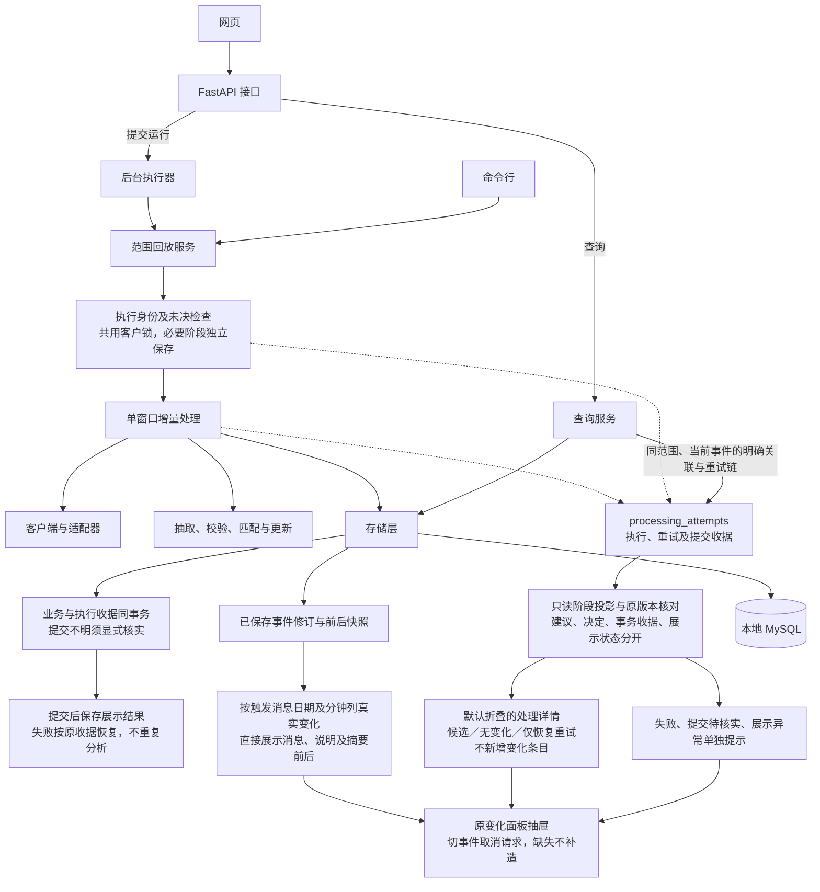

# 工程架构与目录职责

2026-11-13，用户确认在现有增量链路上接入 FastAPI 与前端。此文记录本地工程决定，不修改官方六类事件、评分口径或取数协议。

## 工程边界

同仓库包含 `backend/` 和 `web/`。后端提供业务服务、HTTP 接口、命令行入口与后台执行器；前端只负责输入和展示。MySQL 沿用项目本地容器，数据和 `.env` 保留仓库根目录，迁移代码不迁移或清空已有数据。

## 后端目录

| 路径（相对 `backend/src/dake/`） | 职责 |
| --- | --- |
| `main.py` | 创建 FastAPI 应用、生命周期和接口注册 |
| `config.py` | `.env`、时间范围、独立周期与回溯窗口、待确认缺省 |
| `bootstrap.py` | 组装数据源、分析器、数据库和业务服务，管理连接释放 |
| `cli.py` | 命令参数和脱敏控制台输出 |
| `api/routes/`、`api/schemas.py` | HTTP 输入输出与接口格式，不执行匹配规则 |
| `services/ingestion.py` | 组织取数、适配、消息入库 |
| `services/processing.py` | 一个时间窗口内的增量处理与原子更新 |
| `services/executions.py` | 执行身份、阶段记录、提交核实与按原收据恢复展示；不参与事件归属判断 |
| `services/replay.py` | 按配置划分窗口、逐轮回放、选择继续处理的起点 |
| `services/queries.py` | 查询事件、客户数据概况 |
| `ingestion/client.py`、`ingestion/adapter.py` | 官方 HTTP 调用、多群展开、统一消息转换和原始响应缓存 |
| `domain/models.py` | 与 HTTP 和来源字段无关的消息、候选、事件、窗口与结果 |
| `analysis/providers/` | 可替换抽取接口、stub、获授权的官方 XHub Provider  |
| `analysis/prompts/`、`contract.py`、`attribution.py` | 版本化清洗提示词、基础字段校验与正式归属合约 |
| `analysis/validation.py`、`matching.py`、`updates.py` | 证据校验、批内合并、跨周期识别、事件更新与历史 |
| `repositories/mysql.py` | 消息和事件 SQL、客户锁与事务 |
| `repositories/runs.py` | 持久化运行参数、进度、结果和错误 |
| `repositories/attempts.py` | 按客户和分析范围保存执行／重试、阶段与提交收据；仅收据写入业务连接 |
| `services/execution_changes.py`、`domain/execution_links.py` | 只读执行阶段投影、明确事件引用及收据原版本核对；不参与归属或提交核实 |
| `repositories/local_state.py` | `data/` 内水位、快照及恢复 |
| `jobs/runner.py` | 后台执行运行，保存进度和失败状态 |

`api/schemas.py` 描述网页请求与响应，`domain/models.py` 描述内部业务数据。二者职责不同；数据库记录由存储层转换，不能让接口格式或官方群字段渗入分析规则。

任务提交时冻结模型、输出上限、超时和分析版本；版本由模型、提示词及合约生成。排队期间修改提示词会明确失败，不悄悄换版本执行。查询和任务共用版本计算，旧 stub 标记不会阻止 XHub 重放，普通重跑依旧幂等。结构校验失败允许一次有界纠正；网络失败或最终无效结果仍回滚本窗口。真实请求及响应只写入 `data/raw/xhub/`，不进入日志。

## 复用与增量保证

- 单窗口沿用 `IncrementalService.run_window(uid, window)`；范围回放调用 `ReplayService.run_range(...)`，每个窗口实际执行后才进入下一个。
- 来源协议已改为 `load_window(uid, start, end)`，官方来源在线按分钟请求，`uid=None` 可读取跨客户统一消息；单客户分析服务仍校验 UID，不自动分析其他客户。日期调用和旧离线日期缓存兼容保留，接口事实见 [项目简报 2.3.1](项目简报.md#231-新接口与客户等级2026-11-16-已正式说明)。业务内部用上海时区的 `[start, end)`，消息按 `send_time` 跨群排序。支持补漏重叠读取与消息修订，不把未来窗口交给抽取器。
- 消息按来源与 ID 幂等保存。消息已处理摘要与事件更新在同一事务提交；本地水位只辅助选取下个窗口。
- 正式 XHub 使用已有候选检索、按需旧聊天和明确归属，区分新建、进展、重复与待确认；客户明确确认恢复后才允许建立复发关系。未声明归属的 Provider 使用主题／时间匹配。
- CLI、HTTP 后台任务与后续调度共用上述方法，不另外实现一套网页回放流程。

官方分钟响应回显秒级范围，结束回显为请求结束分钟的下一分钟；适配器先核对回显、总数、群及消息归属，再过滤内部业务窗口。相同来源消息 ID 内容冲突、同群多 UID 或归属缺失均明确失败，不静默丢弃或猜测客户；待确认持久化由后续客户发现功能接入。

分钟缓存位于 `data/raw/official_chat/windows/`，按分钟请求范围和可选 UID 参数的摘要区分。离线单客户请求优先使用对应窗口缓存，缺少时读取原有按日缓存；已有窗口缓存损坏时直接报错。跨客户离线请求必须有对应缓存，不拼接未知覆盖范围的客户文件。缓存保存前完成校验，写入采用私有权限和原子替换。

## 运行记录与页面反馈

消息、事件保留原有 `messages`、`events`。`processing_runs` 是程序运行记录，保存提交参数、运行状态、当前窗口、已完成窗口和每轮变化。网页提交后获得运行 ID，后台执行，页面定期查询；刷新后仍可恢复查看。周期结果先在 `data/run-results/` 保存私有日志，再写任务进度，便于恢复数据库已提交而进度写入中断的情形。

`queued/running/succeeded/failed` 仅表示程序执行状态，不是官方事件状态。失败需要保留已完成窗口并给出脱敏原因。进程中断也必须有明确结果，不能让历史任务永久显示处理中。多次提交仍由业务层的幂等规则防止重复事件。

后台执行器当前使用本机单实例、一个 Uvicorn worker；不包含定时调度和分布式任务平台，也不承诺数据库锁连接断开后的分布式执行隔离。客户事务锁与消息幂等保护事件，任务条件更新防止失权实例覆盖运行进度。扩展调度时继续提交运行并复用同一业务服务。

2026-11-15 新增执行记录第一阶段代码：正式 `bootstrap` 装配 `AttemptRepository`，CLI 和后台经 `run_window` 进入同一记录包装。独立表 `processing_attempts` 持久化 `uid/stream/attempt_id/run_id/window_index/retry_of`、窗口、策略及消息版本指纹、必要阶段和实际无鉴权模型输入；保留模型建议、程序决定、已提交结果三个不同层次。旧记录不补造；网页通过只读变化接口查询执行过程。

阶段通过独立连接追加；关键记录失败即停止并回滚业务，先前阶段仍保留。执行收据最后用业务事务连接写入，与事件、归属和 `processed_by` 原子提交；不靠快照文件或任务成功状态证明提交。收到提交应答后才单独将执行状态确认为 `committed`，因此应答丢失且错误记录失败时，原 `running` 仍阻断后续处理。显式核实在同一客户锁下读取收据并保存核实结果；提交／回滚应答不明不自动重跑。

已提交但快照、水位或任务进度保存失败时，明确重试从原收据及精确事件修订恢复展示，不取数或调模型。每次恢复有新 attempt 并指向原 attempt，标 `delivery_recovery`；当前恢复自身没有事件写入／消息消费。原修订缺失或指纹变化即报缺失，不用未来版本替补，不覆盖后续快照、不倒退水位。任务周期保留 `attempt_id/recovered_from_attempt_id` 并兼容已有 `recovered_from_history` 提示；同窗口不能自行推定执行关联。

内部接口已有 `AttemptRepository.get/for_run_window`、`run_window(..., execution=...)`、`verify_attempt(...)`，CLI `process --retry-attempt` 可显式接续；核实还没有 HTTP／CLI 适配入口。本轮扩展现有 `GET /events/{event_id}/changes`，增加独立的 `execution_offset` 分页和执行阶段投影，已同步 OpenAPI 与生成客户端。先校验当前事件的客户和分析范围，再以明确候选／依据／建议／决定／写入／修订关联及 `retry_of` 链筛选；全量快照成员和同日期不能证明关联。GET 不触发核实、重试、补取或分析，不凭 attempt ID 跨范围查询。

抽屉只读取已保存的版本、片段及观察点：模型建议、程序拟变化、同事务收据证明的写入与提交后展示状态各自展开。提交应答待核实即使已有收据，也不标整批成功；展示恢复不认领原批次写入。原快照或指纹缺失时不借当前版本补齐。正式行存在的周期不再以旧任务重复显示；旧表缺失返回记录不可用并兼容旧批次，查询错误仍报错且不建表。关闭／切换事件沿用原有取消请求和查询键隔离，三栏滚动未改。

变化查询通过 `002_event_link_hints.sql` 增加 STORED 生成列，只提取正式关联条件中可能出现的事件 ID。先扫描范围内的轻量提示和执行身份，再对命中身份分批执行原精确 JSON 条件，之后沿明确重试链分页。提示列允许误命中，不直接证明事件关联；新增关联字段时必须同步迁移表达式及覆盖用例。生成列随阶段与收据原子更新，不引入独立写入状态或关系表；未迁移时兼容原查询。该方案仍扫描范围内轻量提示，尚非无限规模的索引检索。

旧任务使用 `JSON_TABLE` 提取周期身份、写入列表及归属审计，按客户、分析范围和精确事件引用过滤，不扫描或返回每轮完整事件快照。保留原周期序号和旧任务范围规则。接口增加 `include_details`：轻量模式省略大段模型上下文及建议内容，但保留修订、异常、重试及原版本指纹核对。网页首屏使用轻量模式，展开详情后读取完整响应；只在关联执行／任务未结束时轮询，并提供手动刷新。两种模式均为只读，不改变处理、核实或重试行为。

执行记录表的独立迁移文件为 `backend/migrations/001_processing_attempts.sql`，应用启动和 `init-db` 不自动执行。2026-11-16 已只读确认当前本地库包含四张表；新环境须显式迁移后再分析。

## 客户资料与发现

2026-11-16 增加客户页面及手动同步。`ingestion/directory.py` 调用官方 level、TAM 和群搜索；`services/customers.py` 负责窗口内群发现、UID 补查和资料查询；`repositories/customers.py` 保存客户资料和群归属。查询接口仅处理输入输出，不访问外部来源。

显式迁移 `003_customer_directory.sql` 新增 `customer_profiles`、`customer_groups`、`customer_group_history`。客户资料区分未知、查询失败和保留旧值的过期状态；群按来源和稳定 ID 保存，映射变更保留前后记录。归属不明或冲突保留待确认；当前没有人工确认回写接口。

同步使用 `processing_runs.mode=customer_sync`，在原 `RunRunner` 中分派到客户服务，共用领取、执行锁和中断恢复。每次范围最多一天，按配置周期（默认 `15m`）分窗，单任务最多查询 500 个不同客户；同一任务内客户资料只查询一次。每个窗口的客户、群和进度同一事务提交，失败回滚该窗口，已提交窗口保留。重复同步按客户和群主键更新；服务中断明确标为失败，可手动重提相同范围。部分资料或群搜索失败保存有效结果，并以失败终态提示，不伪装全部成功。

来源按业务窗口发现活跃群，不宣称完整群清单。缺 UID 时以群名作一次有界搜索，仅同一群 ID 的唯一明确归属可自动补齐；其他候选保留待确认。已有映射冲突时保留旧 UID 并暂停自动使用。此流程不调用分析 Provider、不生成事件、不将发现客户自动纳入模型处理。

客户页面位于 `web/src/pages/customers/`，包含手动同步、分页客户查询、关联群及待确认群、同步记录与进度。客户查询支持 `segment` 筛选并返回统一分类：L6～L10 为大客户、L0～L5 为非大客户，非 fresh 或未知等级为待确认。`domain/customer_policy.py` 集中定义等级集合及判定，仓库用同一集合生成参数化 SQL，在分页及计数前筛选；不增加持久化分类列。页面默认大客户、URL 保留范围，筛选不触发事件处理。客户同步 API 使用独立响应类型；原事件处理记录接口仅返回 `official` 任务，避免混淆两类任务。客户端由 OpenAPI 生成。

## 前端目录与界面

前端参考 `/home/lq/projects/linq-bs/web` 管理端：React、TypeScript、普通 Umi 4、Tailwind CSS 4、Radix UI、Lucide；使用 npm、Biome、Playwright。不引入 Ant Design。

| 路径（相对 `web/`） | 职责 |
| --- | --- |
| `config/routes.ts`、`config/proxy.ts` | 页面路由与开发接口代理 |
| `src/layouts/` | 简洁侧栏与页面外壳 |
| `src/pages/events/` | 事件列表、筛选与证据、变化详情 |
| `src/pages/runs/` | 提交处理、运行列表和逐轮进度 |
| `src/components/ui/` | 可复用基础控件 |
| `src/services/generated/` | 从 FastAPI OpenAPI 生成的接口调用与类型 |
| `src/services/request.ts` | 请求及统一错误处理 |
| `src/lib/` | 展示格式等小型共享工具 |

事件页使用列表、聊天、详情三栏，运行进度页保留任务列表与逐轮结果。真实客户按已配置的抽取版本查询。长聊天可在详情中展开；仅当消息摘要校验与证据一致时提供完整原文，后续编辑不会覆盖历史证据。官方状态和等级缺省仍为“未知”，不预造业务枚举。

发送者展示身份由 `services/sender_identity.py` 在查询时补充，已确认账号保存在私有的 `data/config/sender_roles.json`，以客户 UID、来源及发送者 ID 联合匹配；前端使用生成合约中的 `sender_role` 决定标签与左右位置。原始 `internal_hint` 保持原值，身份配置不参与消息摘要、模型输入、事件匹配或跟进人推断。按用户要求保留原展示规则：`1` 为右侧“内部”、`0` 为左侧“客户”，未知不展示身份标签；只对已确认的我方客服账号优先采用右侧“客服”。接口标记的完整官方语义仍待确认。

## 验证与后续范围

迁移首先验证现有适配、增量、回放与本地 MySQL 行为。接口增加参数边界、任务状态、失败处理和持久化检查；前端检查类型、构建以及真实后端上的列表、详情、提交和刷新交互。截图只用合成数据。

当前范围包含接口、事件页、处理记录页、客户资料及手动同步页面，以及用户授权的官方样例 XHub 抽取。多客户发现已支持手动同步，分析准入编排与自动调度仍按 [多客户接入与定时增量开发方案](多客户接入与定时增量开发方案.md)推进，尚待实现；其他平台适配器、角色分发和报表仍留待后续，不提前创建不存在的数据源空壳。
